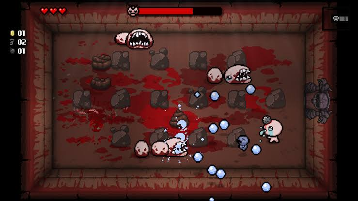
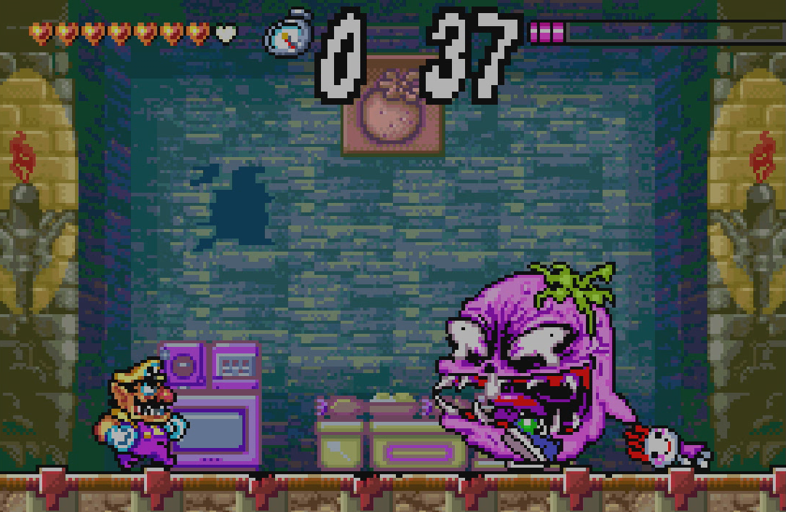
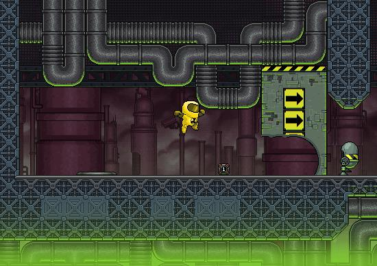
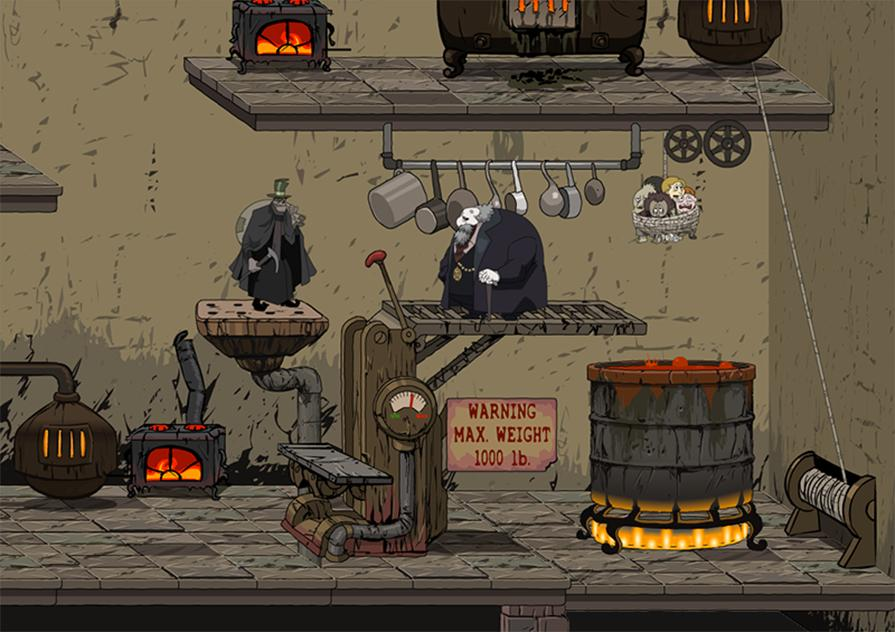
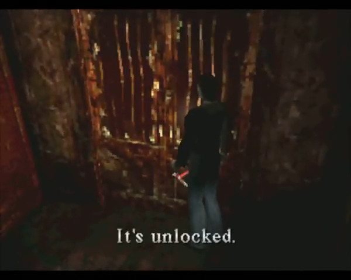
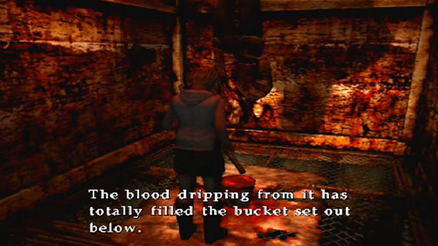
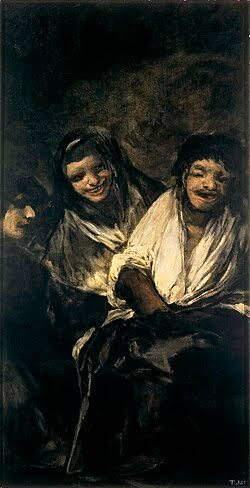
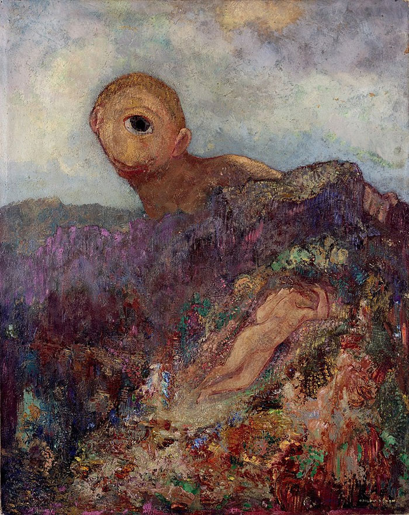

# Краткое описание

Однопользовательский скоростной 2D-платформер с элементами roguelike, вдохновленный Wario Land 4.

# Характеристики игры

- Жанр: платформер
- Целевая аудитория: 12+
- Настроение: комедия ошибок, деконструкция жанра
- Сеттинг: наше время, параллельный мир (Тартар)
- Тема: потеря человечности, капиталистическая эксплуатация, угнетение сознания
- Технология: Construct 3
- Монетизация: Pay-to-play

# Описание игрового процесса

## Общее описание

В процессе игры игрок:

- Сражается с монстрами: мелкие противники и боссы проверяют владение боевой системой и платформингом
- Проходит уровни: каждый уровень имеет секреты и испытания (комнаты Shuffle Time, боссы)
- Находит новые предметы: каждый предмет открывает какую-то способность или накладывает бафф/дебафф
- Пробует разные билды: вариативность билдов повышает реиграбельность и позволяет получать разный опыт при прохождении одного и того же уровня

## Цели игры

| Краткосрочные                | Среднесрочные            | Долгосрочные                |
|------------------------------|--------------------------|-----------------------------|
| Преодоление препятствий      | Прохождение уровней      | Повышение выручки ресторана |
| Битвы с мелкими противниками | Битвы с боссами          |                             |
| Поиск предметов              | Получение высокого ранга |                             |

## Слои геймплея

### Платформинг и боевая система

Платформинг и боевая система тесно связаны, так что рассматривать их отдельно не получится.

Без предметов игроку доступен самый базовый мувсет:

- Перемещение вправо/влево
- Прыжок

Атаки:

- Атаки собственным телом (dive attack, удар с разбега)
- Парирование

### Шкала стиля

Уровень стиля растет в зависимости от разнообразности атак или выполнения других условий (например, за парирования или долгое нахождение в воздухе). Накладывает множитель урона.

### Предметы

По мере продвижения по уровню игрок находит предметы.

Игрок может держать только три предмета.

Предметы расширяют возможности персонажа. Примеры предметов:

- Шляпа: добавляет dash
- Фейерверк: добавляет двойной прыжок
- Morph ball: игрок превращается в шар, сбивающий все на своем пути
- Дробовик (или пистолет): добавляет атаку на средней дистанции

Некоторые предметы добавляют дебаффы, которые, тем не менее, можно использовать в свою пользу:

- Свинцовый костюм (сильно замедляет игрока, но клоуз-комбат наносит утроенный урон и оглушает врагов)

### Уровни

Как выглядит типичный уровень в игре:

- Первый проход. Цель - дойти до конца и что-то там сделать. (Например, победить босса или дотронуться до какого-нибудь предмета, как в Wario Land.)
- Побег (второй проход). Цель - покинуть уровень за определённое время. Если время закончится до того, как игрок добежал до входа, то игра заканчивается, игрок теряет все собранные предметы.

Во время побега открытые ранее пути закрываются, на уровне появляются новые враги, новые препятствия и так далее. Плюс такого подхода в том, что время прохождения одного и того же уровня увеличивается в два раза.

### Shuffle Time

На каждом уровне есть несколько особенных комнат. Когда игрок заходит в такую комнату, таймер прохождения уровня останавливается, все выходы закрываются.

В комнате находятся несколько особенно сложных врагов. Чтобы выйти из комнаты, надо убить всех врагов за определенное время.

В случае победы игрок получает три случайных предмета. В случае неудачи игрок возрождается у входа в комнату. Чтобы попробовать перепройти комнату, нужно начать уровень заново.

### Боссы

Примеры боссов:

- Молестриос: стационарный босс. Тест на платформинг. Спамит hitscan и area denial. Цель - выжить в течение 90 секунд.
- Дональд Трамп: по мувсету похож на Смоуга из Dark Souls. Таранит игрока, делает сальто. Его дропкик оглушает игрока на несколько секунд.

# Синопсис сюжета

Ресторан Andre's Steakhouse близок к закрытию из-за непопулярности и плохих отзывов. Однажды Гарфилд обнаруживает в подвале ресторана дыру в стене, которая ведёт в тоннель. На другом конце тоннеля он обнаруживает Тартар.

Тартар - это параллельный мир, представляющий собой порождение коллективного бессознательного. Его структура не поддается логике, а человеческие грехи, страхи и желания материализуются в виде монстров.

Тартар полон денег и сокровищ (проявление подсознательной жадности). Чем больше игрок соберет, тем выше будет ранг за уровень.

## Протагонист

Главный герой игры - Гарфилд л'Занья, ассистент менеджера в ресторане Andre's Steakhouse. Его цель - спасти ресторан от закрытия и получить повышение.

## Антагонист

Главным антагонистом является Дональд Трамп (скорее, его образ). Он проявился в Тартаре из-за испытываемой человечеством ненависти к нему.

# Ценности дизайна

- Высокая реиграбельность 
- Требовательный платформинг
- Сложные боссы
- Система рангов (от D до SSS), получаемых за прохождение уровней

# USP

- Смесь платформинга Wario Land и системы билдов The Binding of Isaac
- Вариативность (благодаря возможности использовать множество разных комбинаций предметов)

# Визуальный стиль

## Стиль игры

\newpage

\newpage

\newpage

\newpage

## Разное

\newpage

\newpage

\newpage

\newpage

# Референсы

- Wario Land 4 (главный источник вдохновения: платформинг)
- Pizza Tower (скорость и game feel)
- Silent Hill 4 (атмосфера и механика путешествия по разным мирам)
- The Binding of Isaac (использование предметов, билды)
